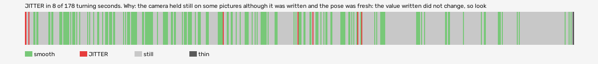

# visceral-re8-vr (openxr, VR, headset or simulator not recorded)

Log `visceral-re8-vr_20261126-232745.jl`, checked 2026-11-26 23:37. `[measured]`: one VR session.

JITTER in 8 of 178 turning seconds. Why: the camera held still on some pictures although it was written and the pose was fresh: the value written did not change, so look at what sits between the pose and the camera (a smoothing step, a rounding, a once-per-tick game update).

- quality: **good**
- 550.03 s; 71.4 pictures, 71.4 pose reads, 71.4 camera writes a second
- turning 178 s, jitter 8 s

## Why

- the camera held still on some pictures although it was written and the pose was fresh: the value written did not change, so look at what sits between the pose and the camera (a smoothing step, a rounding, a once-per-tick game update)

## Controllers (Occlusion Drift BeG0nE)

- left: 71.4 reads a second; untracked 64.9% of the time, longest 180.22 s; 99% of the untracked reads came while the other controller was within 0.3 m
- right: 71.4 reads a second; untracked 69.5% of the time, longest 189.8 s; 92% of the untracked reads came while the other controller was within 0.3 m

## Marks the mod left

- 0.0 s: rebuild2 off=[] scriptbody_off=0

## On the recording

- **OpenXR headset view (OBS Mirror)**: `begone_second_2026-11-26_23-27-52.mp4`; the log starts -7.30 s into it (log clock).
  - jitter 199-200s: 90 frames; on screen 1 pictures held, 5 jumped, in `<recordings>/visceral-re8-vr/begone-frames/2026-11-26_23-36-55_openxr/jitter_199-200s_headset/` (sheet.jpg)
  - jitter 274-275s: 90 frames; on screen 1 pictures held, 5 jumped, in `<recordings>/visceral-re8-vr/begone-frames/2026-11-26_23-36-55_openxr/jitter_274-275s_headset/` (sheet.jpg)
  - jitter 289-290s: 90 frames; on screen 2 pictures held, 1 jumped, in `<recordings>/visceral-re8-vr/begone-frames/2026-11-26_23-36-55_openxr/jitter_289-290s_headset/` (sheet.jpg)
  - smooth 9-10s: 90 frames; on screen 2 pictures held, 4 jumped, in `<recordings>/visceral-re8-vr/begone-frames/2026-11-26_23-36-55_openxr/smooth_9-10s_headset/` (sheet.jpg)
- **game window**: `begone_2026-11-26_23-27-52.mp4`; the log starts -7.30 s into it (log clock).
  - jitter 199-200s: 90 frames; on screen 9 pictures held, 7 jumped, in `<recordings>/visceral-re8-vr/begone-frames/2026-11-26_23-36-55_openxr/jitter_199-200s_game/` (sheet.jpg)
  - jitter 274-275s: 90 frames; on screen 7 pictures held, 2 jumped, in `<recordings>/visceral-re8-vr/begone-frames/2026-11-26_23-36-55_openxr/jitter_274-275s_game/` (sheet.jpg)
  - jitter 289-290s: 90 frames; on screen 12 pictures held, 3 jumped, in `<recordings>/visceral-re8-vr/begone-frames/2026-11-26_23-36-55_openxr/jitter_289-290s_game/` (sheet.jpg)
  - smooth 9-10s: 90 frames; on screen 8 pictures held, 7 jumped, in `<recordings>/visceral-re8-vr/begone-frames/2026-11-26_23-36-55_openxr/smooth_9-10s_game/` (sheet.jpg)
