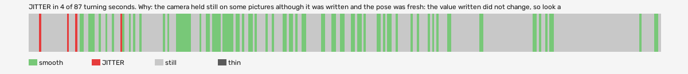

# visceral-re8-vr (openxr, VR, headset or simulator not recorded)

Log `visceral-re8-vr_20261126-233846.jl`, checked 2026-11-26 23:44. `[measured]`: one VR session.

JITTER in 4 of 87 turning seconds. Why: the camera held still on some pictures although it was written and the pose was fresh: the value written did not change, so look at what sits between the pose and the camera (a smoothing step, a rounding, a once-per-tick game update).

- quality: **good**
- 295.29 s; 71.6 pictures, 71.6 pose reads, 71.6 camera writes a second
- turning 87 s, jitter 4 s

## Why

- the camera held still on some pictures although it was written and the pose was fresh: the value written did not change, so look at what sits between the pose and the camera (a smoothing step, a rounding, a once-per-tick game update)

## Controllers (Occlusion Drift BeG0nE)

- left: 71.6 reads a second; untracked 69.4% of the time, longest 106.7 s; 95% of the untracked reads came while the other controller was within 0.3 m
- right: 71.6 reads a second; untracked 65.8% of the time, longest 100.01 s; 100% of the untracked reads came while the other controller was within 0.3 m

## Marks the mod left

- 0.0 s: rebuild2 off=[] scriptbody_off=0

## On the recording

- **OpenXR headset view (OBS Mirror)**: `begone_second_2026-11-26_23-38-57.mp4`; the log starts -11.34 s into it (log clock).
  - jitter 18-19s: 90 frames; on screen 0 pictures held, 2 jumped, in `<recordings>/visceral-re8-vr/begone-frames/2026-11-26_23-43-41_openxr/jitter_18-19s_headset/` (sheet.jpg)
  - jitter 22-23s: 90 frames; on screen 1 pictures held, 5 jumped, in `<recordings>/visceral-re8-vr/begone-frames/2026-11-26_23-43-41_openxr/jitter_22-23s_headset/` (sheet.jpg)
  - jitter 43-44s: 90 frames; on screen 0 pictures held, 3 jumped, in `<recordings>/visceral-re8-vr/begone-frames/2026-11-26_23-43-41_openxr/jitter_43-44s_headset/` (sheet.jpg)
  - smooth 24-25s: 90 frames; on screen 0 pictures held, 1 jumped, in `<recordings>/visceral-re8-vr/begone-frames/2026-11-26_23-43-41_openxr/smooth_24-25s_headset/` (sheet.jpg)
- **game window**: `begone_2026-11-26_23-38-57.mp4`; the log starts -11.34 s into it (log clock).
  - jitter 18-19s: 90 frames; on screen 1 pictures held, 2 jumped, in `<recordings>/visceral-re8-vr/begone-frames/2026-11-26_23-43-41_openxr/jitter_18-19s_game/` (sheet.jpg)
  - jitter 22-23s: 90 frames; on screen 3 pictures held, 3 jumped, in `<recordings>/visceral-re8-vr/begone-frames/2026-11-26_23-43-41_openxr/jitter_22-23s_game/` (sheet.jpg)
  - jitter 43-44s: 90 frames; on screen 9 pictures held, 3 jumped, in `<recordings>/visceral-re8-vr/begone-frames/2026-11-26_23-43-41_openxr/jitter_43-44s_game/` (sheet.jpg)
  - smooth 24-25s: 90 frames; on screen 8 pictures held, 1 jumped, in `<recordings>/visceral-re8-vr/begone-frames/2026-11-26_23-43-41_openxr/smooth_24-25s_game/` (sheet.jpg)
