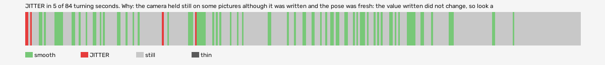

# visceral-re8-vr (openxr, VR, headset or simulator not recorded)

Log `visceral-re8-vr_20261126-234522.jl`, checked 2026-11-26 23:51. `[measured]`: one VR session.

JITTER in 5 of 84 turning seconds. Why: the camera held still on some pictures although it was written and the pose was fresh: the value written did not change, so look at what sits between the pose and the camera (a smoothing step, a rounding, a once-per-tick game update).

- quality: **good**
- 319.52 s; 70.9 pictures, 70.9 pose reads, 70.9 camera writes a second
- turning 84 s, jitter 5 s

## Why

- the camera held still on some pictures although it was written and the pose was fresh: the value written did not change, so look at what sits between the pose and the camera (a smoothing step, a rounding, a once-per-tick game update)

## Controllers (Occlusion Drift BeG0nE)

- left: 70.9 reads a second; untracked 68.8% of the time, longest 218.94 s; 89% of the untracked reads came while the other controller was within 0.3 m
- right: 70.9 reads a second; untracked 61.5% of the time, longest 110.91 s; 100% of the untracked reads came while the other controller was within 0.3 m

## Marks the mod left

- 0.0 s: rebuild2 off=[] scriptbody_off=0

## On the recording

- **OpenXR headset view (OBS Mirror)**: `begone_second_2026-11-26_23-45-29.mp4`; the log starts -7.37 s into it (log clock).
  - jitter 79-80s: 90 frames; on screen 0 pictures held, 1 jumped, in `<recordings>/visceral-re8-vr/begone-frames/2026-11-26_23-50-41_openxr/jitter_79-80s_headset/` (sheet.jpg)
  - jitter 98-99s: 90 frames; on screen 0 pictures held, 4 jumped, in `<recordings>/visceral-re8-vr/begone-frames/2026-11-26_23-50-41_openxr/jitter_98-99s_headset/` (sheet.jpg)
  - smooth 8-9s: 90 frames; on screen 1 pictures held, 4 jumped, in `<recordings>/visceral-re8-vr/begone-frames/2026-11-26_23-50-41_openxr/smooth_8-9s_headset/` (sheet.jpg)
- **game window**: `begone_2026-11-26_23-45-29.mp4`; the log starts -7.37 s into it (log clock).
  - jitter 79-80s: 90 frames; on screen 7 pictures held, 2 jumped, in `<recordings>/visceral-re8-vr/begone-frames/2026-11-26_23-50-41_openxr/jitter_79-80s_game/` (sheet.jpg)
  - jitter 98-99s: 90 frames; on screen 11 pictures held, 5 jumped, in `<recordings>/visceral-re8-vr/begone-frames/2026-11-26_23-50-41_openxr/jitter_98-99s_game/` (sheet.jpg)
  - smooth 8-9s: 90 frames; on screen 7 pictures held, 6 jumped, in `<recordings>/visceral-re8-vr/begone-frames/2026-11-26_23-50-41_openxr/smooth_8-9s_game/` (sheet.jpg)
