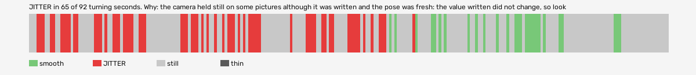

# visceral-re8-vr (openxr, VR, headset or simulator not recorded)

Log `visceral-re8-vr_20261126-235151.jl`, checked 2026-11-26 23:56. `[measured]`: one VR session.

JITTER in 65 of 92 turning seconds. Why: the camera held still on some pictures although it was written and the pose was fresh: the value written did not change, so look at what sits between the pose and the camera (a smoothing step, a rounding, a once-per-tick game update).

- quality: **good**
- 244.39 s; 70.0 pictures, 70.0 pose reads, 70.0 camera writes a second
- turning 92 s, jitter 65 s

## Why

- the camera held still on some pictures although it was written and the pose was fresh: the value written did not change, so look at what sits between the pose and the camera (a smoothing step, a rounding, a once-per-tick game update)

## Controllers (Occlusion Drift BeG0nE)

- left: 70.0 reads a second; untracked 62.9% of the time, longest 95.23 s; 65% of the untracked reads came while the other controller was within 0.3 m
- right: 70.0 reads a second; untracked 42.5% of the time, longest 49.95 s; 89% of the untracked reads came while the other controller was within 0.3 m

## Marks the mod left

- 0.0 s: rebuild2 off=[] scriptbody_off=0

## On the recording

- **OpenXR headset view (OBS Mirror)**: `begone_second_2026-11-26_23-52-00.mp4`; the log starts -9.02 s into it (log clock).
  - jitter 12-16s: 150 frames; on screen 2 pictures held, 1 jumped, in `<recordings>/visceral-re8-vr/begone-frames/2026-11-26_23-55-56_openxr/jitter_12-16s_headset/` (sheet.jpg)
  - jitter 17-19s: 150 frames; on screen 1 pictures held, 5 jumped, in `<recordings>/visceral-re8-vr/begone-frames/2026-11-26_23-55-56_openxr/jitter_17-19s_headset/` (sheet.jpg)
  - jitter 25-28s: 150 frames; on screen 1 pictures held, 0 jumped, in `<recordings>/visceral-re8-vr/begone-frames/2026-11-26_23-55-56_openxr/jitter_25-28s_headset/` (sheet.jpg)
  - smooth 138-139s: 90 frames; on screen 1 pictures held, 0 jumped, in `<recordings>/visceral-re8-vr/begone-frames/2026-11-26_23-55-56_openxr/smooth_138-139s_headset/` (sheet.jpg)
- **game window**: `begone_2026-11-26_23-52-00.mp4`; the log starts -9.02 s into it (log clock).
  - jitter 12-16s: 150 frames; on screen 16 pictures held, 2 jumped, in `<recordings>/visceral-re8-vr/begone-frames/2026-11-26_23-55-56_openxr/jitter_12-16s_game/` (sheet.jpg)
  - jitter 17-19s: 150 frames; on screen 12 pictures held, 4 jumped, in `<recordings>/visceral-re8-vr/begone-frames/2026-11-26_23-55-56_openxr/jitter_17-19s_game/` (sheet.jpg)
  - jitter 25-28s: 150 frames; on screen 22 pictures held, 2 jumped, in `<recordings>/visceral-re8-vr/begone-frames/2026-11-26_23-55-56_openxr/jitter_25-28s_game/` (sheet.jpg)
  - smooth 138-139s: 90 frames; on screen 8 pictures held, 5 jumped, in `<recordings>/visceral-re8-vr/begone-frames/2026-11-26_23-55-56_openxr/smooth_138-139s_game/` (sheet.jpg)
