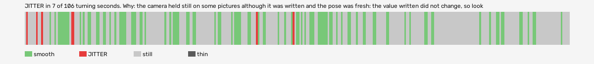

# visceral-re8-vr (openxr, VR, headset or simulator not recorded)

Log `visceral-re8-vr_20261127-000549.jl`, checked 2026-11-27 00:11. `[measured]`: one VR session.

JITTER in 7 of 106 turning seconds. Why: the camera held still on some pictures although it was written and the pose was fresh: the value written did not change, so look at what sits between the pose and the camera (a smoothing step, a rounding, a once-per-tick game update).

- quality: **good**
- 326.89 s; 70.9 pictures, 70.9 pose reads, 70.9 camera writes a second
- turning 106 s, jitter 7 s

## Why

- the camera held still on some pictures although it was written and the pose was fresh: the value written did not change, so look at what sits between the pose and the camera (a smoothing step, a rounding, a once-per-tick game update)

## Controllers (Occlusion Drift BeG0nE)

- left: 70.9 reads a second; untracked 69.3% of the time, longest 224.35 s; 97% of the untracked reads came while the other controller was within 0.3 m
- right: 70.9 reads a second; untracked 67.4% of the time, longest 220.05 s; 100% of the untracked reads came while the other controller was within 0.3 m

## Marks the mod left

- 0.0 s: rebuild2 off=[] scriptbody_off=0

## On the recording

- **OpenXR headset view (OBS Mirror)**: `begone_second_2026-11-27_00-05-56.mp4`; the log starts -7.14 s into it (log clock).
  - jitter 10-11s: 90 frames; on screen 3 pictures held, 10 jumped, in `<recordings>/visceral-re8-vr/begone-frames/2026-11-27_00-11-16_openxr/jitter_10-11s_headset/` (sheet.jpg)
  - jitter 28-30s: 150 frames; on screen 0 pictures held, 1 jumped, in `<recordings>/visceral-re8-vr/begone-frames/2026-11-27_00-11-16_openxr/jitter_28-30s_headset/` (sheet.jpg)
  - jitter 139-140s: 90 frames; on screen 2 pictures held, 6 jumped, in `<recordings>/visceral-re8-vr/begone-frames/2026-11-27_00-11-16_openxr/jitter_139-140s_headset/` (sheet.jpg)
  - smooth 15-16s: 90 frames; on screen 2 pictures held, 0 jumped, in `<recordings>/visceral-re8-vr/begone-frames/2026-11-27_00-11-16_openxr/smooth_15-16s_headset/` (sheet.jpg)
- **game window**: `begone_2026-11-27_00-05-56.mp4`; the log starts -7.14 s into it (log clock).
  - jitter 10-11s: 90 frames; on screen 2 pictures held, 3 jumped, in `<recordings>/visceral-re8-vr/begone-frames/2026-11-27_00-11-16_openxr/jitter_10-11s_game/` (sheet.jpg)
  - jitter 28-30s: 150 frames; on screen 12 pictures held, 1 jumped, in `<recordings>/visceral-re8-vr/begone-frames/2026-11-27_00-11-16_openxr/jitter_28-30s_game/` (sheet.jpg)
  - jitter 139-140s: 90 frames; on screen 11 pictures held, 7 jumped, in `<recordings>/visceral-re8-vr/begone-frames/2026-11-27_00-11-16_openxr/jitter_139-140s_game/` (sheet.jpg)
  - smooth 15-16s: 90 frames; on screen 13 pictures held, 1 jumped, in `<recordings>/visceral-re8-vr/begone-frames/2026-11-27_00-11-16_openxr/smooth_15-16s_game/` (sheet.jpg)
