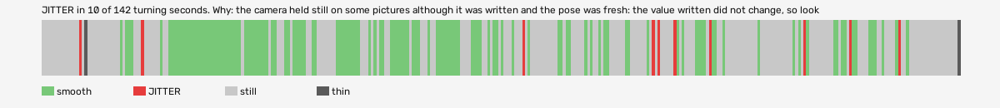

# visceral-re8-vr (openxr, VR, headset or simulator not recorded)

Log `visceral-re8-vr_20261127-001238.jl`, checked 2026-11-27 00:18. `[measured]`: one VR session.

JITTER in 10 of 142 turning seconds. Why: the camera held still on some pictures although it was written and the pose was fresh: the value written did not change, so look at what sits between the pose and the camera (a smoothing step, a rounding, a once-per-tick game update).

- quality: **good**
- 339.19 s; 70.4 pictures, 70.4 pose reads, 70.4 camera writes a second
- turning 142 s, jitter 10 s

## Why

- the camera held still on some pictures although it was written and the pose was fresh: the value written did not change, so look at what sits between the pose and the camera (a smoothing step, a rounding, a once-per-tick game update)

## Controllers (Occlusion Drift BeG0nE)

- left: 70.4 reads a second; untracked 58.9% of the time, longest 183.24 s; 98% of the untracked reads came while the other controller was within 0.3 m
- right: 70.4 reads a second; untracked 61.2% of the time, longest 189.46 s; 95% of the untracked reads came while the other controller was within 0.3 m

## Marks the mod left

- 0.0 s: rebuild2 off=[] scriptbody_off=0

## On the recording

- **OpenXR headset view (OBS Mirror)**: `begone_second_2026-11-27_00-12-46.mp4`; the log starts -8.92 s into it (log clock).
  - jitter 14-15s: 90 frames; on screen 0 pictures held, 1 jumped, in `<recordings>/visceral-re8-vr/begone-frames/2026-11-27_00-18-17_openxr/jitter_14-15s_headset/` (sheet.jpg)
  - jitter 37-38s: 90 frames; on screen 0 pictures held, 0 jumped, in `<recordings>/visceral-re8-vr/begone-frames/2026-11-27_00-18-17_openxr/jitter_37-38s_headset/` (sheet.jpg)
  - jitter 178-179s: 90 frames; on screen 0 pictures held, 3 jumped, in `<recordings>/visceral-re8-vr/begone-frames/2026-11-27_00-18-17_openxr/jitter_178-179s_headset/` (sheet.jpg)
  - smooth 29-30s: 90 frames; on screen 0 pictures held, 4 jumped, in `<recordings>/visceral-re8-vr/begone-frames/2026-11-27_00-18-17_openxr/smooth_29-30s_headset/` (sheet.jpg)
- **game window**: `begone_2026-11-27_00-12-46.mp4`; the log starts -8.92 s into it (log clock).
  - jitter 14-15s: 90 frames; on screen 11 pictures held, 0 jumped, in `<recordings>/visceral-re8-vr/begone-frames/2026-11-27_00-18-17_openxr/jitter_14-15s_game/` (sheet.jpg)
  - jitter 37-38s: 90 frames; on screen 5 pictures held, 0 jumped, in `<recordings>/visceral-re8-vr/begone-frames/2026-11-27_00-18-17_openxr/jitter_37-38s_game/` (sheet.jpg)
  - jitter 178-179s: 90 frames; on screen 10 pictures held, 4 jumped, in `<recordings>/visceral-re8-vr/begone-frames/2026-11-27_00-18-17_openxr/jitter_178-179s_game/` (sheet.jpg)
  - smooth 29-30s: 90 frames; on screen 13 pictures held, 5 jumped, in `<recordings>/visceral-re8-vr/begone-frames/2026-11-27_00-18-17_openxr/smooth_29-30s_game/` (sheet.jpg)
