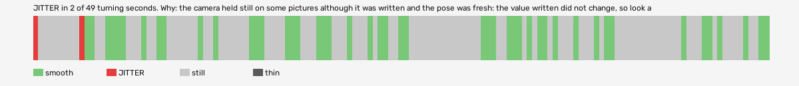

# visceral-re8-vr (openxr, VR, headset or simulator not recorded)

Log `visceral-re8-vr_20261127-002022.jl`, checked 2026-11-27 00:23. `[measured]`: one VR session.

JITTER in 2 of 49 turning seconds. Why: the camera held still on some pictures although it was written and the pose was fresh: the value written did not change, so look at what sits between the pose and the camera (a smoothing step, a rounding, a once-per-tick game update).

- quality: **good**
- 142.32 s; 71.2 pictures, 71.2 pose reads, 71.2 camera writes a second
- turning 49 s, jitter 2 s

## Why

- the camera held still on some pictures although it was written and the pose was fresh: the value written did not change, so look at what sits between the pose and the camera (a smoothing step, a rounding, a once-per-tick game update)

## Controllers (Occlusion Drift BeG0nE)

- left: 71.2 reads a second; untracked 50.1% of the time, longest 70.73 s; 100% of the untracked reads came while the other controller was within 0.3 m
- right: 71.2 reads a second; untracked 50.6% of the time, longest 71.37 s; 99% of the untracked reads came while the other controller was within 0.3 m

## Marks the mod left

- 0.0 s: rebuild2 off=[] scriptbody_off=0

## On the recording

- **OpenXR headset view (OBS Mirror)**: `begone_second_2026-11-27_00-20-30.mp4`; the log starts -7.90 s into it (log clock).
  - jitter 9-10s: 90 frames; on screen 3 pictures held, 7 jumped, in `<recordings>/visceral-re8-vr/begone-frames/2026-11-27_00-22-44_openxr/jitter_9-10s_headset/` (sheet.jpg)
  - smooth 10-11s: 90 frames; on screen 3 pictures held, 2 jumped, in `<recordings>/visceral-re8-vr/begone-frames/2026-11-27_00-22-44_openxr/smooth_10-11s_headset/` (sheet.jpg)
- **game window**: `begone_2026-11-27_00-20-30.mp4`; the log starts -7.90 s into it (log clock).
  - jitter 9-10s: 90 frames; on screen 5 pictures held, 4 jumped, in `<recordings>/visceral-re8-vr/begone-frames/2026-11-27_00-22-44_openxr/jitter_9-10s_game/` (sheet.jpg)
  - smooth 10-11s: 90 frames; on screen 10 pictures held, 3 jumped, in `<recordings>/visceral-re8-vr/begone-frames/2026-11-27_00-22-44_openxr/smooth_10-11s_game/` (sheet.jpg)
