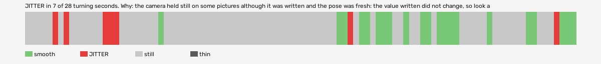

# visceral-re8-vr (openxr, VR, headset or simulator not recorded)

Log `visceral-re8-vr_20261127-002358.jl`, checked 2026-11-27 00:26. `[measured]`: one VR session.

JITTER in 7 of 28 turning seconds. Why: the camera held still on some pictures although it was written and the pose was fresh: the value written did not change, so look at what sits between the pose and the camera (a smoothing step, a rounding, a once-per-tick game update).

- quality: **good**
- 98.95 s; 71.2 pictures, 71.2 pose reads, 71.2 camera writes a second
- turning 28 s, jitter 7 s

## Why

- the camera held still on some pictures although it was written and the pose was fresh: the value written did not change, so look at what sits between the pose and the camera (a smoothing step, a rounding, a once-per-tick game update)

## Controllers (Occlusion Drift BeG0nE)

- left: 71.2 reads a second; untracked 36.0% of the time, longest 19.26 s; 59% of the untracked reads came while the other controller was within 0.3 m
- right: 71.2 reads a second; untracked 29.2% of the time, longest 27.06 s; 73% of the untracked reads came while the other controller was within 0.3 m

## Marks the mod left

- 0.0 s: rebuild2 off=[] scriptbody_off=0

## On the recording

- **OpenXR headset view (OBS Mirror)**: `begone_second_2026-11-27_00-24-08.mp4`; the log starts -9.91 s into it (log clock).
  - jitter 14-17s: 150 frames; on screen 0 pictures held, 0 jumped, in `<recordings>/visceral-re8-vr/begone-frames/2026-11-27_00-25-37_openxr/jitter_14-17s_headset/` (sheet.jpg)
  - jitter 58-59s: 90 frames; on screen 0 pictures held, 0 jumped, in `<recordings>/visceral-re8-vr/begone-frames/2026-11-27_00-25-37_openxr/jitter_58-59s_headset/` (sheet.jpg)
  - jitter 95-96s: 90 frames; on screen 0 pictures held, 7 jumped, in `<recordings>/visceral-re8-vr/begone-frames/2026-11-27_00-25-37_openxr/jitter_95-96s_headset/` (sheet.jpg)
  - smooth 24-25s: 90 frames; on screen 0 pictures held, 1 jumped, in `<recordings>/visceral-re8-vr/begone-frames/2026-11-27_00-25-37_openxr/smooth_24-25s_headset/` (sheet.jpg)
- **game window**: `begone_2026-11-27_00-24-08.mp4`; the log starts -9.91 s into it (log clock).
  - jitter 14-17s: 150 frames; on screen 18 pictures held, 2 jumped, in `<recordings>/visceral-re8-vr/begone-frames/2026-11-27_00-25-37_openxr/jitter_14-17s_game/` (sheet.jpg)
  - jitter 58-59s: 90 frames; on screen 8 pictures held, 1 jumped, in `<recordings>/visceral-re8-vr/begone-frames/2026-11-27_00-25-37_openxr/jitter_58-59s_game/` (sheet.jpg)
  - jitter 95-96s: 90 frames; on screen 12 pictures held, 5 jumped, in `<recordings>/visceral-re8-vr/begone-frames/2026-11-27_00-25-37_openxr/jitter_95-96s_game/` (sheet.jpg)
  - smooth 24-25s: 90 frames; on screen 9 pictures held, 5 jumped, in `<recordings>/visceral-re8-vr/begone-frames/2026-11-27_00-25-37_openxr/smooth_24-25s_game/` (sheet.jpg)
