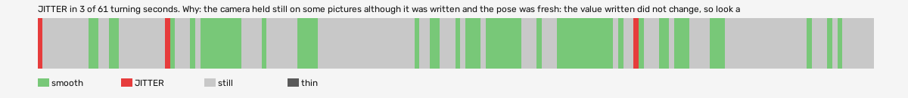

# visceral-re8-vr (openxr, VR, headset or simulator not recorded)

Log `visceral-re8-vr_20261127-002815.jl`, checked 2026-11-27 00:31. `[measured]`: one VR session.

JITTER in 3 of 61 turning seconds. Why: the camera held still on some pictures although it was written and the pose was fresh: the value written did not change, so look at what sits between the pose and the camera (a smoothing step, a rounding, a once-per-tick game update).

- quality: **good**
- 163.37 s; 71.4 pictures, 71.4 pose reads, 71.4 camera writes a second
- turning 61 s, jitter 3 s

## Why

- the camera held still on some pictures although it was written and the pose was fresh: the value written did not change, so look at what sits between the pose and the camera (a smoothing step, a rounding, a once-per-tick game update)

## Controllers (Occlusion Drift BeG0nE)

- left: 71.4 reads a second; untracked 38.7% of the time, longest 31.74 s; 100% of the untracked reads came while the other controller was within 0.3 m
- right: 71.4 reads a second; untracked 47.2% of the time, longest 44.51 s; 91% of the untracked reads came while the other controller was within 0.3 m

## Marks the mod left

- 0.0 s: rebuild2 off=[] scriptbody_off=0

## On the recording

- **OpenXR headset view (OBS Mirror)**: `begone_second_2026-11-27_00-28-25.mp4`; the log starts -10.04 s into it (log clock).
  - jitter 25-26s: 90 frames; on screen 1 pictures held, 0 jumped, in `<recordings>/visceral-re8-vr/begone-frames/2026-11-27_00-30-58_openxr/jitter_25-26s_headset/` (sheet.jpg)
  - jitter 117-118s: 90 frames; on screen 1 pictures held, 1 jumped, in `<recordings>/visceral-re8-vr/begone-frames/2026-11-27_00-30-58_openxr/jitter_117-118s_headset/` (sheet.jpg)
  - smooth 11-12s: 90 frames; on screen 2 pictures held, 4 jumped, in `<recordings>/visceral-re8-vr/begone-frames/2026-11-27_00-30-58_openxr/smooth_11-12s_headset/` (sheet.jpg)
- **game window**: `begone_2026-11-27_00-28-25.mp4`; the log starts -10.04 s into it (log clock).
  - jitter 25-26s: 90 frames; on screen 9 pictures held, 0 jumped, in `<recordings>/visceral-re8-vr/begone-frames/2026-11-27_00-30-58_openxr/jitter_25-26s_game/` (sheet.jpg)
  - jitter 117-118s: 90 frames; on screen 10 pictures held, 2 jumped, in `<recordings>/visceral-re8-vr/begone-frames/2026-11-27_00-30-58_openxr/jitter_117-118s_game/` (sheet.jpg)
  - smooth 11-12s: 90 frames; on screen 11 pictures held, 5 jumped, in `<recordings>/visceral-re8-vr/begone-frames/2026-11-27_00-30-58_openxr/smooth_11-12s_game/` (sheet.jpg)
