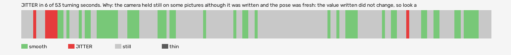

# visceral-re8-vr (openxr, VR, headset or simulator not recorded)

Log `visceral-re8-vr_20261127-003204.jl`, checked 2026-11-27 00:35. `[measured]`: one VR session.

JITTER in 6 of 53 turning seconds. Why: the camera held still on some pictures although it was written and the pose was fresh: the value written did not change, so look at what sits between the pose and the camera (a smoothing step, a rounding, a once-per-tick game update).

- quality: **good**
- 154.52 s; 71.5 pictures, 71.5 pose reads, 71.5 camera writes a second
- turning 53 s, jitter 6 s

## Why

- the camera held still on some pictures although it was written and the pose was fresh: the value written did not change, so look at what sits between the pose and the camera (a smoothing step, a rounding, a once-per-tick game update)

## Controllers (Occlusion Drift BeG0nE)

- left: 71.5 reads a second; untracked 58.3% of the time, longest 68.97 s; 99% of the untracked reads came while the other controller was within 0.3 m
- right: 71.5 reads a second; untracked 61.6% of the time, longest 68.52 s; 93% of the untracked reads came while the other controller was within 0.3 m

## Marks the mod left

- 0.0 s: rebuild2 off=[] scriptbody_off=0

## On the recording

- **OpenXR headset view (OBS Mirror)**: `begone_second_2026-11-27_00-32-10.mp4`; the log starts -6.58 s into it (log clock).
  - jitter 8-12s: 150 frames; on screen 3 pictures held, 11 jumped, in `<recordings>/visceral-re8-vr/begone-frames/2026-11-27_00-34-38_openxr/jitter_8-12s_headset/` (sheet.jpg)
  - jitter 127-128s: 90 frames; on screen 2 pictures held, 6 jumped, in `<recordings>/visceral-re8-vr/begone-frames/2026-11-27_00-34-38_openxr/jitter_127-128s_headset/` (sheet.jpg)
  - smooth 12-13s: 90 frames; on screen 3 pictures held, 3 jumped, in `<recordings>/visceral-re8-vr/begone-frames/2026-11-27_00-34-38_openxr/smooth_12-13s_headset/` (sheet.jpg)
- **game window**: `begone_2026-11-27_00-32-10.mp4`; the log starts -6.58 s into it (log clock).
  - jitter 8-12s: 150 frames; on screen 19 pictures held, 23 jumped, in `<recordings>/visceral-re8-vr/begone-frames/2026-11-27_00-34-38_openxr/jitter_8-12s_game/` (sheet.jpg)
  - jitter 127-128s: 90 frames; on screen 12 pictures held, 1 jumped, in `<recordings>/visceral-re8-vr/begone-frames/2026-11-27_00-34-38_openxr/jitter_127-128s_game/` (sheet.jpg)
  - smooth 12-13s: 90 frames; on screen 11 pictures held, 5 jumped, in `<recordings>/visceral-re8-vr/begone-frames/2026-11-27_00-34-38_openxr/smooth_12-13s_game/` (sheet.jpg)
