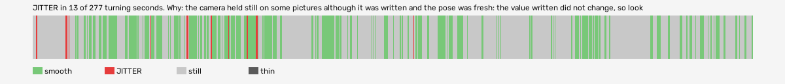

# visceral-re8-vr (openxr, VR, headset or simulator not recorded)

Log `visceral-re8-vr_20261127-011123.jl`, checked 2026-11-27 01:24. `[measured]`: one VR session.

JITTER in 13 of 277 turning seconds. Why: the camera held still on some pictures although it was written and the pose was fresh: the value written did not change, so look at what sits between the pose and the camera (a smoothing step, a rounding, a once-per-tick game update).

- quality: **good**
- 738.4 s; 67.5 pictures, 67.5 pose reads, 67.5 camera writes a second
- turning 277 s, jitter 13 s

## Why

- the camera held still on some pictures although it was written and the pose was fresh: the value written did not change, so look at what sits between the pose and the camera (a smoothing step, a rounding, a once-per-tick game update)

## Controllers (Occlusion Drift BeG0nE)

- left: 67.5 reads a second; untracked 24.7% of the time, longest 61.51 s; 93% of the untracked reads came while the other controller was within 0.3 m
- right: 67.5 reads a second; untracked 34.3% of the time, longest 120.22 s; 67% of the untracked reads came while the other controller was within 0.3 m

## Marks the mod left

- 0.0 s: rebuild2 off=[] scriptbody_off=0

## On the recording

- **OpenXR headset view (OBS Mirror)**: `begone_second_2026-11-27_01-11-35.mp4`; the log starts -12.26 s into it (log clock).
  - jitter 34-36s: 150 frames; on screen 0 pictures held, 1 jumped, in `<recordings>/visceral-re8-vr/begone-frames/2026-11-27_01-23-42_openxr/jitter_34-36s_headset/` (sheet.jpg)
  - jitter 37-38s: 90 frames; on screen 2 pictures held, 5 jumped, in `<recordings>/visceral-re8-vr/begone-frames/2026-11-27_01-23-42_openxr/jitter_37-38s_headset/` (sheet.jpg)
  - jitter 121-122s: 90 frames; on screen 3 pictures held, 2 jumped, in `<recordings>/visceral-re8-vr/begone-frames/2026-11-27_01-23-42_openxr/jitter_121-122s_headset/` (sheet.jpg)
  - smooth 44-45s: 90 frames; on screen 0 pictures held, 0 jumped, in `<recordings>/visceral-re8-vr/begone-frames/2026-11-27_01-23-42_openxr/smooth_44-45s_headset/` (sheet.jpg)
- **game window**: `begone_2026-11-27_01-11-35.mp4`; the log starts -12.26 s into it (log clock).
  - jitter 34-36s: 150 frames; on screen 16 pictures held, 2 jumped, in `<recordings>/visceral-re8-vr/begone-frames/2026-11-27_01-23-42_openxr/jitter_34-36s_game/` (sheet.jpg)
  - jitter 37-38s: 90 frames; on screen 10 pictures held, 2 jumped, in `<recordings>/visceral-re8-vr/begone-frames/2026-11-27_01-23-42_openxr/jitter_37-38s_game/` (sheet.jpg)
  - jitter 121-122s: 90 frames; on screen 3 pictures held, 3 jumped, in `<recordings>/visceral-re8-vr/begone-frames/2026-11-27_01-23-42_openxr/jitter_121-122s_game/` (sheet.jpg)
  - smooth 44-45s: 90 frames; on screen 10 pictures held, 2 jumped, in `<recordings>/visceral-re8-vr/begone-frames/2026-11-27_01-23-42_openxr/smooth_44-45s_game/` (sheet.jpg)
