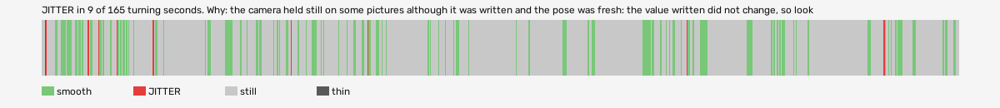

# visceral-re8-vr (openxr, VR, headset or simulator not recorded)

Log `visceral-re8-vr_20261127-012454.jl`, checked 2026-11-27 01:38. `[measured]`: one VR session.

JITTER in 9 of 165 turning seconds. Why: the camera held still on some pictures although it was written and the pose was fresh: the value written did not change, so look at what sits between the pose and the camera (a smoothing step, a rounding, a once-per-tick game update).

- quality: **good**
- 789.94 s; 68.2 pictures, 68.2 pose reads, 68.2 camera writes a second
- turning 165 s, jitter 9 s

## Why

- the camera held still on some pictures although it was written and the pose was fresh: the value written did not change, so look at what sits between the pose and the camera (a smoothing step, a rounding, a once-per-tick game update)

## Controllers (Occlusion Drift BeG0nE)

- left: 68.2 reads a second; untracked 55.4% of the time, longest 129.02 s; 96% of the untracked reads came while the other controller was within 0.3 m
- right: 68.2 reads a second; untracked 60.3% of the time, longest 148.99 s; 88% of the untracked reads came while the other controller was within 0.3 m

## Marks the mod left

- 0.0 s: rebuild2 off=[] scriptbody_off=0

## On the recording

- **OpenXR headset view (OBS Mirror)**: `begone_second_2026-11-27_01-25-01.mp4`; the log starts -7.01 s into it (log clock).
  - jitter 40-41s: 90 frames; on screen 1 pictures held, 3 jumped, in `<recordings>/visceral-re8-vr/begone-frames/2026-11-27_01-38-04_openxr/jitter_40-41s_headset/` (sheet.jpg)
  - jitter 49-50s: 90 frames; on screen 3 pictures held, 1 jumped, in `<recordings>/visceral-re8-vr/begone-frames/2026-11-27_01-38-04_openxr/jitter_49-50s_headset/` (sheet.jpg)
  - jitter 65-66s: 90 frames; on screen 1 pictures held, 3 jumped, in `<recordings>/visceral-re8-vr/begone-frames/2026-11-27_01-38-04_openxr/jitter_65-66s_headset/` (sheet.jpg)
  - smooth 12-13s: 90 frames; on screen 12 pictures held, 4 jumped, in `<recordings>/visceral-re8-vr/begone-frames/2026-11-27_01-38-04_openxr/smooth_12-13s_headset/` (sheet.jpg)
- **game window**: `begone_2026-11-27_01-25-01.mp4`; the log starts -7.01 s into it (log clock).
  - jitter 40-41s: 90 frames; on screen 10 pictures held, 2 jumped, in `<recordings>/visceral-re8-vr/begone-frames/2026-11-27_01-38-04_openxr/jitter_40-41s_game/` (sheet.jpg)
  - jitter 49-50s: 90 frames; on screen 9 pictures held, 1 jumped, in `<recordings>/visceral-re8-vr/begone-frames/2026-11-27_01-38-04_openxr/jitter_49-50s_game/` (sheet.jpg)
  - jitter 65-66s: 90 frames; on screen 11 pictures held, 6 jumped, in `<recordings>/visceral-re8-vr/begone-frames/2026-11-27_01-38-04_openxr/jitter_65-66s_game/` (sheet.jpg)
  - smooth 12-13s: 90 frames; on screen 14 pictures held, 7 jumped, in `<recordings>/visceral-re8-vr/begone-frames/2026-11-27_01-38-04_openxr/smooth_12-13s_game/` (sheet.jpg)
