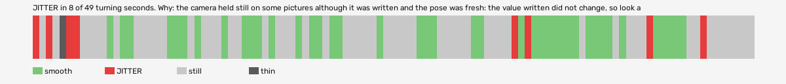

# visceral-re8-vr (openxr, VR, headset or simulator not recorded)

Log `visceral-re8-vr_20261127-014230.jl`, checked 2026-11-27 01:44. `[measured]`: one VR session.

JITTER in 8 of 49 turning seconds. Why: the camera held still on some pictures although it was written and the pose was fresh: the value written did not change, so look at what sits between the pose and the camera (a smoothing step, a rounding, a once-per-tick game update).

- quality: **good**
- 106.83 s; 66.8 pictures, 66.8 pose reads, 66.8 camera writes a second
- turning 49 s, jitter 8 s

## Why

- the camera held still on some pictures although it was written and the pose was fresh: the value written did not change, so look at what sits between the pose and the camera (a smoothing step, a rounding, a once-per-tick game update)

## Controllers (Occlusion Drift BeG0nE)

- left: 66.8 reads a second; untracked 19.5% of the time, longest 20.12 s; 100% of the untracked reads came while the other controller was within 0.3 m
- right: 66.8 reads a second; untracked 22.1% of the time, longest 22.72 s; 88% of the untracked reads came while the other controller was within 0.3 m

## Marks the mod left

- 0.0 s: rebuild2 off=[] scriptbody_off=0

## On the recording

- **OpenXR headset view (OBS Mirror)**: `begone_second_2026-11-27_01-42-39.mp4`; the log starts -9.26 s into it (log clock).
  - jitter 71-72s: 90 frames; on screen 3 pictures held, 4 jumped, in `<recordings>/visceral-re8-vr/begone-frames/2026-11-27_01-44-17_openxr/jitter_71-72s_headset/` (sheet.jpg)
  - jitter 73-74s: 90 frames; on screen 1 pictures held, 6 jumped, in `<recordings>/visceral-re8-vr/begone-frames/2026-11-27_01-44-17_openxr/jitter_73-74s_headset/` (sheet.jpg)
  - jitter 91-92s: 90 frames; on screen 3 pictures held, 5 jumped, in `<recordings>/visceral-re8-vr/begone-frames/2026-11-27_01-44-17_openxr/jitter_91-92s_headset/` (sheet.jpg)
  - smooth 11-12s: 90 frames; on screen 7 pictures held, 2 jumped, in `<recordings>/visceral-re8-vr/begone-frames/2026-11-27_01-44-17_openxr/smooth_11-12s_headset/` (sheet.jpg)
- **game window**: `begone_2026-11-27_01-42-39.mp4`; the log starts -9.26 s into it (log clock).
  - jitter 71-72s: 90 frames; on screen 10 pictures held, 3 jumped, in `<recordings>/visceral-re8-vr/begone-frames/2026-11-27_01-44-17_openxr/jitter_71-72s_game/` (sheet.jpg)
  - jitter 73-74s: 90 frames; on screen 10 pictures held, 3 jumped, in `<recordings>/visceral-re8-vr/begone-frames/2026-11-27_01-44-17_openxr/jitter_73-74s_game/` (sheet.jpg)
  - jitter 91-92s: 90 frames; on screen 9 pictures held, 2 jumped, in `<recordings>/visceral-re8-vr/begone-frames/2026-11-27_01-44-17_openxr/jitter_91-92s_game/` (sheet.jpg)
  - smooth 11-12s: 90 frames; on screen 12 pictures held, 6 jumped, in `<recordings>/visceral-re8-vr/begone-frames/2026-11-27_01-44-17_openxr/smooth_11-12s_game/` (sheet.jpg)
